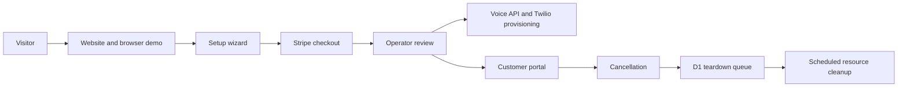

# Marisol — customer website and portal

The customer-facing application for an AI phone receptionist serving US barbershops and
pet-grooming salons. It connects a bilingual marketing site and browser voice demo to onboarding,
subscription billing, an operator-reviewed activation flow and a multi-location customer portal.
The repository retains its original name, `kaijiro-voice-landing`.

[Product website](https://callmarisol.com) ·
[Voice API repository](https://github.com/PtSik/marisol-voice-api)

## What is implemented

- English and Spanish public pages, pricing and onboarding.
- An interactive browser voice demo using ElevenLabs WebRTC.
- A six-step setup wizard with persisted drafts and conflict handling.
- Stripe subscription checkout, plan changes and scheduled cancellation.
- A client portal for setup, calendar connection, billing, referrals and multiple locations.
- Operator-reviewed activation, with a durable teardown queue for cancellation cleanup.

## Architecture

| Layer | Implementation |
| --- | --- |
| UI | React, TypeScript, Tailwind CSS |
| Framework | Vinext with Next.js-compatible App Router APIs, built with Vite |
| Runtime | Cloudflare Worker, entry point `worker/launch.ts` |
| State | Cloudflare KV and D1 |
| Integrations | Stripe, ElevenLabs, Twilio, Resend, Google sign-in |
| Voice backend | Separate `voice-agent` Worker, service binding and authenticated admin API |
| Checks | Biome, TypeScript, Bun tests and production build |



Checkout records a paid setup awaiting review; it does not automatically activate a phone
number. Cancellation uses a persisted queue so external-service failures can be retried.

## Local checks

Install Bun and use the committed lockfile. The version used in CI is pinned in
[`.github/workflows/ci.yml`](./.github/workflows/ci.yml).

```bash
bun install --frozen-lockfile
bun run typecheck
bunx biome ci .
bun run test
bun run build
```

The tests mock external services. They cover billing transitions, provisioning safety, portal
access, onboarding, localization and teardown behavior without making real purchases or calls.
A passing build is not an end-to-end verification of live integrations.

## Local development

```bash
cp .env.example .dev.vars
bun run dev
```

Public pages can be inspected separately from provider-backed flows. To exercise the complete
application, configure your own development KV and D1 resources, apply the D1 migrations, connect
a development voice worker and supply sandbox credentials. See `wrangler.jsonc` for bindings,
`.env.example` for credential names. The onboarding implementation starts in
`components/onboarding/OnboardingWizard.tsx`. The checked-in deployment configuration describes the existing product;
replace its resource IDs, domains, service bindings and price IDs before deploying a fork.

The existing hosted preview shares some production integrations. Do not use it for checkout or
provisioning tests. Use an isolated sandbox with Stripe test prices and test credentials.

## Code walkthrough

| Area | Starting point |
| --- | --- |
| Public UI and translations | `components/LandingPage.tsx`, `components/sections/`, `lib/i18n/` |
| Setup wizard | `components/onboarding/OnboardingWizard.tsx` |
| Checkout settlement | `lib/checkoutSettlement.ts` |
| Portal authorization | `lib/portalAccess.ts` |
| Activation | `lib/provisioning.ts`, `lib/activationLock.ts` |
| Durable cleanup | `lib/teardownQueue.ts`, `worker/launch.ts` |
| Tests | `lib/__tests__/` |

## Deployment

GitHub Actions in this public repository runs checks and builds only. It does not deploy.
The repository preserves the product's historical configuration; provision your own resources
and review environment bindings before deploying a fork. Database migrations are a separate step.

Live demos can use paid external services. For a code review without credentials, use the local
checks above. No customer credentials or production datasets are needed for those checks.
